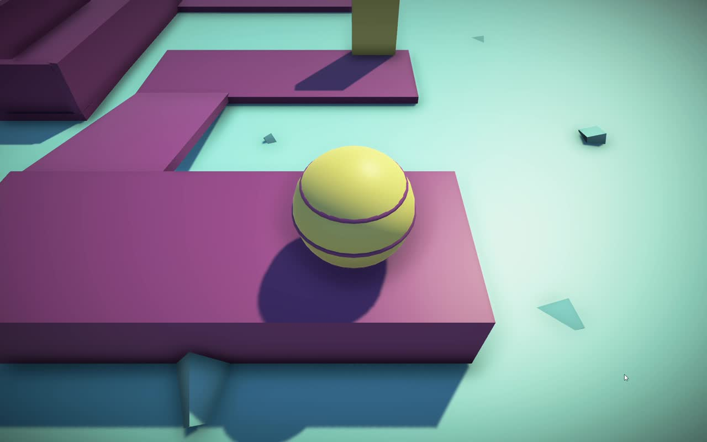

# Balance Rush
### A 3D Ball Platformer Built with Unity

## Overview

Balance Rush is a 3D ball-platforming game built with Unity. Players guide a ball through elevated obstacle courses, cross narrow bridges, and stay on track to reach the finish line. Careful movement and timing are essential to completing each level.

## Gameplay & Features

- **Ball navigation:** Guide the ball along narrow paths and around obstacles.
- **Bridges and obstacles:** Navigate course sections that challenge precision and control.
- **Level restart:** Falling off the course into the fall zone restarts the current level.
- **Level progression:** Reach the finish line to advance to the next level.
- **3D presentation:** Colorful environments with an elevated view of the course.

## Development Highlights

Developed this 3D game using Unity.

## Technology

| Tool | Purpose |
| --- | --- |
| Unity | 3D game development |

## Gameplay Video

[**Watch the gameplay demo (23 seconds)**](https://github.com/Shatha-algobaishi/balance-rush/blob/main/media/gameplay.mp4)

The clip shows ball movement, narrow paths, a bridge, and obstacles.
